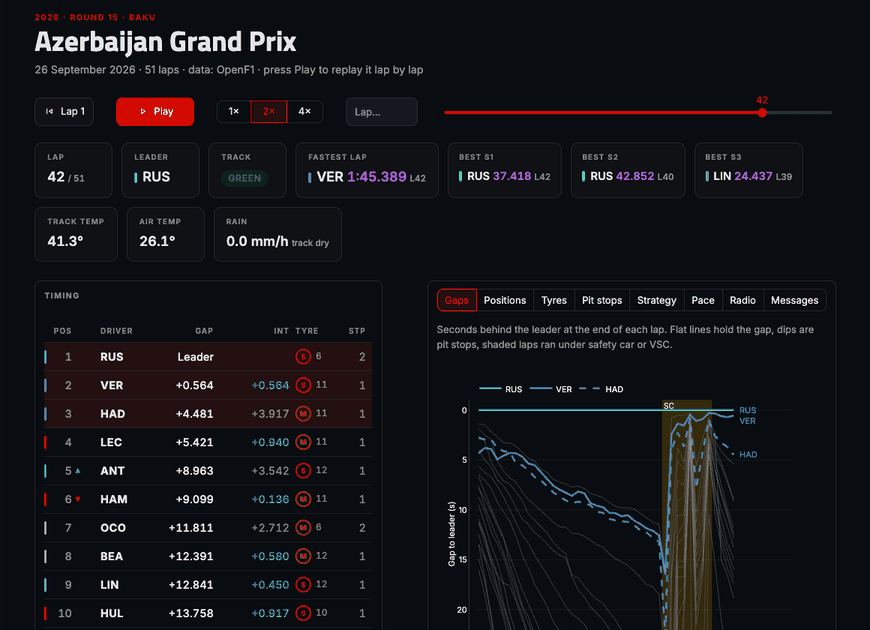
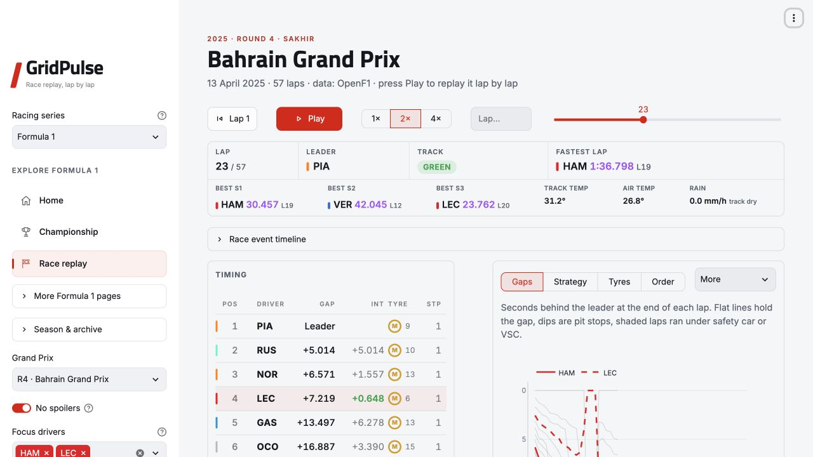
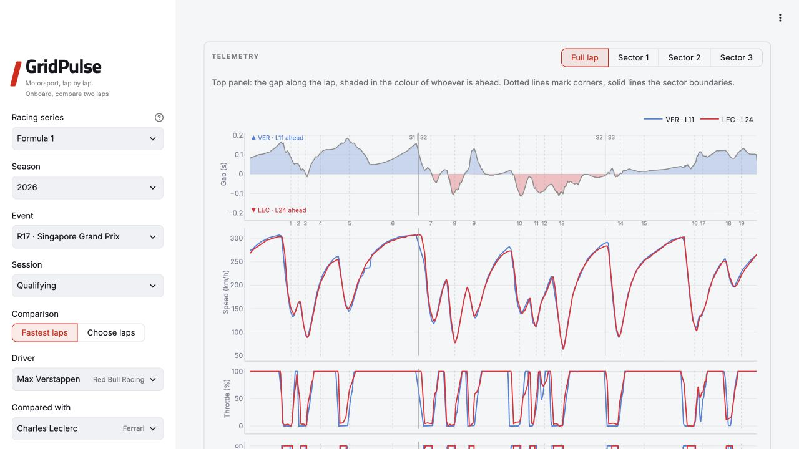
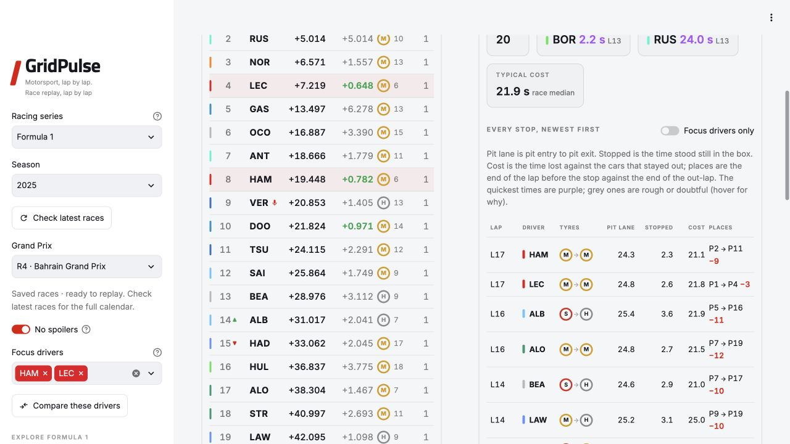
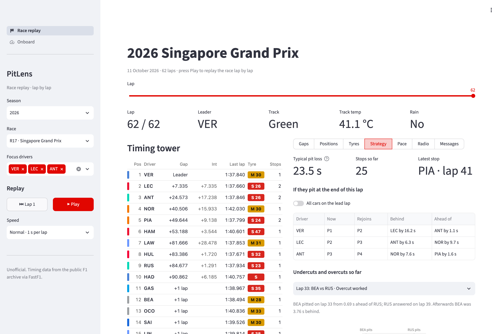
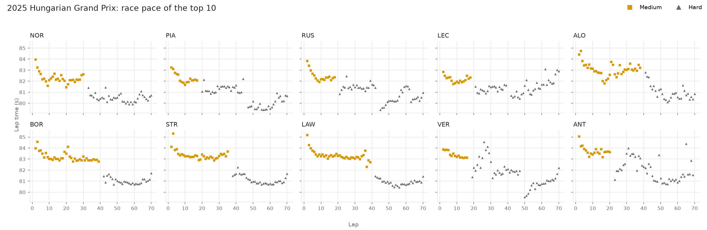
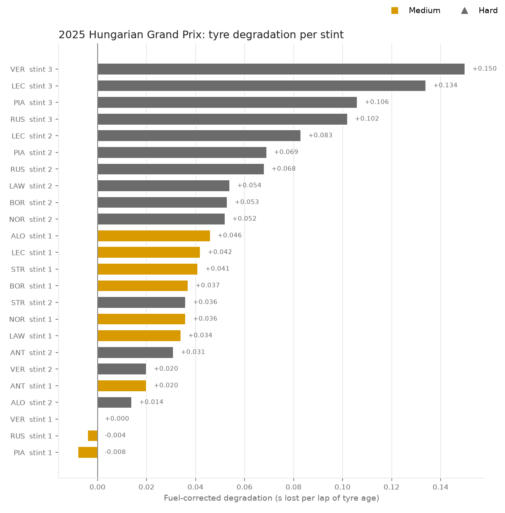

<div align="center">

# GridPulse

**Motorsport, lap by lap.**

Replay any race from the pit wall, lap by lap, and measure what the tyres were really doing:<br>
the same questions a strategy desk asks on a Sunday afternoon.

Current data coverage is **Formula 1** and **DTM (2023–2026)**. GT World Challenge
and other championships are planned additions.

[](https://github.com/KaiQ7an/gridpulse/actions/workflows/test.yml)


[](LICENSE)

[Open GridPulse](https://gridpulse-racing.streamlit.app/) · [Quick start](#quick-start) · [macOS / Homebrew](#macos-with-homebrew) · [Pit wall](#pit-wall) · [Onboard](#onboard) · [Pit stops](#pit-stops) · [Strategy](#strategy) · [Tyre analysis](#tyre-analysis) · [How it works](#how-it-works) · [Roadmap](ROADMAP.md)

</div>

<p align="center">
  
  <br><sub><b>Pit wall</b> · replaying the last laps of the 2026 Azerbaijan Grand Prix, which Russell won by 0.196 s</sub>
</p>

## Why

Lap times on a broadcast tower are noisy: in-laps, safety cars, traffic and a car that gets
lighter every lap all hide what the tyres are actually doing. GridPulse turns the public F1 timing
feed (via [FastF1](https://github.com/theOehrly/Fast-F1)) into what a race engineer would want on
their screens: who is where and on what tyre, how gaps are moving, and how fast each stint is
falling away, with the cleaning rules written down and tested.

## Features

**DTM** (`/dtm`)

- Use the **Racing series** switcher at the top left to move between Formula 1 and DTM.
  Both championships use the same sidebar menu style and retain their selections when you switch away.
- Official 2023–2026 driver, team and manufacturer standings, retaining published order,
  race points and qualifying points. Interactive cumulative points charts with hover details
  and selectable entries; manufacturer colours and distinct line patterns.
- A clickable calendar opens a weekend overview: Race 1 and Race 2 podiums, plus the top
  three from both qualifying sessions (groups stay separate). Each card opens its full
  classification with one click. Practice and full results retain lap times, gaps,
  pit-stop counts and DNF/DNS/DSQ statuses.
- Compare up to four drivers: points, wins, podiums and classified finishes through the season.
  Share links retain the season, view, weekend, session and compared drivers. Export tables as CSV.
- **Teams**: introductions for the selected season’s participating teams, including guests.
  Headquarters, founding background, team history, dated honours, sponsored entrant names,
  season drivers, first points, first win and results. GT3 models and attributed photographs sit inside each team profile;
  model reference photos are labelled when they do not show that team’s season livery.
- **Drivers**: biographical introductions, birthday, nationality, DTM debut, season portrait,
  official profile links, first-points/first-win milestones and race-by-race results. F1's Drivers page has the same profile card.
- **Circuits**: the selected season’s eight venues on an interactive globe and Europe map, official DTM layout diagrams,
  sourced venue histories, length comparisons and links back to the race weekend. Covered records (fastest race lap,
  most wins and qualifying P1s) use 2023 through the selected season; qualifying groups stay separate from combined P1s.
- Driver menus show full names on the left and their session/season teams on the right; multi-select tags keep names only.
- Official data from [dtm.com](https://www.dtm.com/en/results). The current season refreshes
  every 30 minutes while in use; a refresh button checks any supported year. Bundled official
  snapshots keep the section usable offline or during an upstream failure. The fetched time
  and provisional status are shown. This section provides classifications, not telemetry replay.
- Refresh a checked-in snapshot with `python -m pitlens.dtm.refresh --year 2026`.
  See [DTM data coverage](docs/dtm-data.md) for adapter boundaries and verification.

**`pitwall`: race-day dashboard** (available now)

- Any race from 2018 to the latest Grand Prix, picked from the sidebar, and on sprint weekends the
  sprint as well.
- **Replay**: a player bar under the header. Press Play and the whole dashboard advances a lap at a
  time (1×, 2× or 4×), drag the slider, or type a lap number to jump straight to it. A status strip shows the lap,
  leader, track status, fastest lap so far and the weather.
- **Event timeline**: hover or focus a pit stop, pass, fastest lap, retirement or track-status
  change; click to pause and jump to that lap. Filter by event type or use the event picker on
  crowded laps. Spoiler-free mode only sends events through the current replay lap to the browser.
- **Timing tower**: running order with a green ▲ or red ▼ for places gained or lost on the lap
  (against the starting grid on lap 1), gap to the leader, interval (green when within a second), last
  lap, tyre compound and age, stops, lapped cars and retirements, with a pit flag on the lap a car
  boxes and your focus drivers highlighted. Under a safety car, VSC or red flag a banner slides in
  above it with the number of laps run so far. During a replay rows
  slide into place on overtakes and the gaps count smoothly from lap to lap.
- **Gaps** (the race trace): seconds behind the leader for every car, focus drivers in team colours.
- **Positions**, **tyre stints** in running order, **degradation so far** for the focus drivers,
  **clean-lap pace** by compound, and race control **messages** up to the current lap.
- Track status, fastest lap and fastest sectors so far (in purple, with team colours; hover a sector
  for P2 and P3 and their gaps), track temperature and rainfall in mm/h at the current lap; safety car
  and VSC laps shaded. F1's feed only says whether the track sensor sees rain, so the millimetres
  come from Open-Meteo's hourly weather-model estimate for the circuit.
- **Race feed**: what happened lap by lap (pit stops, passes on track, new fastest laps, safety
  cars, retirements, the finish) with a one-line state of the race on top. While the replay moves
  forward, new fastest laps, retirements, race control (safety car, VSC, red flag, green flag) and
  the winner at the chequered flag also pop up as in-page notifications styled like the broadcast
  graphics.
- **Circuit map**: the track drawn from the race's fastest lap as actually driven (or the circuit
  outline before 2023), with the start/finish line, and the fastest S1/S2/S3 so far beside it.
- **Pit stops**: every stop so far, newest first, with how long it took (pit entry to exit, and
  the time stood still in the box where the timing feed has it), tyres off and on, the time it
  cost against the cars that stayed out and the places lost; the quickest stops and the quickest
  crews by team; and what each stop cost lap by lap. Drives through the pit lane on the same tyres
  (a penalty, or the field sent through behind the safety car) aren't counted as stops.
- **Strategy**: the typical pit loss, where each car would rejoin if it pitted at the end of this
  lap and how many laps on new tyres it would take to close on the car ahead, a **pit window**
  (the best lap to stop and what stopping earlier or later costs, from a tyre model fitted on the
  race's laps so far), and every undercut and overcut so far with its outcome.
- **Radio**: team radio clips up to the current lap, playable in the page, with a microphone in
  the timing tower when a driver's clip comes in. One click turns the clips into text with a
  local Whisper model, and another translates them into Chinese; transcribed radio also appears as
  quotes in the race feed.

**Qualifying** (a page in the pit wall)

- The knockout classification: Q1, Q2 and Q3 times with the fastest of each part in purple,
  dashed lines where cars went out, gap to pole, and each driver's ideal lap (their best three
  sectors added up) with the time they left on the table.
- Where the time went: every driver's best sector against the fastest of the session.
- Every push lap through the session, showing the track getting quicker as it rubbers in.
- Sprint qualifying on sprint weekends. Deleted laps are left out (from race control's
  "TIME ... DELETED" messages when the data comes from OpenF1).

**Teams** (a page in the pit wall)

- A season team by team, from the saved races: constructors' points, wins, podiums, poles, both
  cars in the points and retirements, and each driver's numbers, tied to a team race by race so
  mid-season swaps land in the right place.
- The teammate battle: who finished ahead and who out-qualified whom, and the median qualifying
  gap in the last part both set a time in.
- Every Grand Prix finish for both drivers, the constructors' table, and the pit crew's median
  stationary time against every other team's.
- Headquarters, founding background, sourced history and dated constructors’ titles for the
  2023–2026 entrants. Only the selected season’s teams appear; predecessor titles stay separate.
  Links open a team directly: `/teams?year=2025&team=McLaren`.

**Season** (a page in the pit wall)

- The championship from the saved races: drivers' and constructors' standings with the gap to
  the leader, the points race through the year, and who led the championship after which rounds.
- Every Grand Prix finish in one grid, drivers in championship order and rounds across, coloured
  for the podium, points and retirements, with pole and fastest lap marked.
- Round by round: pole, winner, fastest lap and sprint winner, each opening its replay.

**Drivers** (a page in the pit wall)

- One driver's season: points, wins, podiums, poles, fastest laps, laps led and retirements, the
  average grid slot and finish, places gained a race, and the teammate battle.
- Grid to flag at every Grand Prix, points through the year against the teammate and the leader,
  and every weekend's qualifying, grid, finish, sprint and points.
- Highlights picked from the season: best comeback, the win from furthest back, poles turned into
  wins, hat-tricks (pole, win and fastest lap), the longest run in the points.

**Circuits** (a page in the pit wall)

- An interactive world globe with circuit markers, rotation, zoom and four regional maps:
  Europe & Caucasus, the Americas, Asia-Pacific and the Middle East. Select a marker, browse
  a region or search by circuit, city or country; circuit facts work without saved race data.
- Filter circuit cards by permanent, street or hybrid layouts; sort by name, length or first
  Grand Prix. A result count and Clear filters action make it easy to recover an empty search.
- Hover or focus a circuit card to rotate the globe toward it and preview its facts; map markers
  highlight the corresponding card and country without a page reload.
- **Corner guide**: hover the racing line or numbered turns, pin a corner, step with the arrow
  buttons/keys, or play a lap tour. Drag the progress bar, pause and resume, and choose 0.5×,
  1× or 2× preview speed. Copy a pinned corner link to restore it on another visit, for example
  `/circuits?region=asia-pacific&circuit=suzuka&corner=T15`.
  Speed, gear and approximate brake-on approach distance come
  from an explicitly labelled reference lap. Missing telemetry or numbered geometry stays unavailable;
  the tour animation is a visual guide, not a real-time replay. Reference tours are bundled offline;
  rebuild them with `.venv/bin/python tools/update_corner_tours.py` using saved races and source caches.
- **Compare circuits**: select up to three venues and switch between length, median reference pit
  loss, the percentage of saved races with a full safety car, and stops per classified finisher.
  Each venue's saved years and sample size remain visible. Export all metrics and coverage as
  CSV; shared links retain the selected metric, for example
  `/circuits?compare=monza,suzuka&metric=safety-cars`.
- Each circuit has layout length, race laps, first Grand Prix, a track outline and an introduction,
  plus F1's published race lap record and the drivers with the most wins and pole starts at that
  venue. Historical records include tied leaders, years, source links and a reference date;
  they are separate from the locally saved race statistics below.
- One track across the saved years, matched by circuit rather than name (Monaco and Monte Carlo
  are the same place): winner and where they started, pole and fastest race lap times, safety
  cars, VSCs, red flags and rain, and the winner's tyres.
- Pole and fastest lap year on year, how many times the finishers stopped, the most used tyre
  run, and the circuit's pit stop cost.
- Pages open from links: `/season?year=2025`, `/drivers?year=2025&driver=NOR`,
  `/circuits?circuit=monza`.
- Open the atlas at `/circuits`, or a regional map at `/circuits?region=asia-pacific`.
  Facts and records are bundled for offline use. Refresh the reference data from the repository
  root with `.venv/bin/python tools/update_circuit_atlas.py --as-of YYYY-MM-DD`.
  The updater caches source responses in `cache/atlas`; add `--refresh` when updating the reference.
  Map geometry is public-domain [Natural Earth](https://www.naturalearthdata.com/),
  rendered with the bundled [D3](https://d3js.org/) library (ISC license in the component directory).

**`onboard`: telemetry lap comparison** (available now)

- Any two drivers in any session, defaulting to the fastest driver and their teammate.
- In the dashboard, switch to **Choose laps** for any two valid timed laps, including two laps from
  the same driver. The lap pickers show time, compound and tyre age; deleted laps are excluded.
  Team colours and solid/dashed lines distinguish teammates or two laps from the same driver.
  Links preserve both choices: `/onboard?year=2025&round=4&session=R&drivers=HAM,HAM&mode=laps&lap_a=10&lap_b=20`.
- A plain-English summary of where the lap was won: sectors, and the corners with the biggest gains.
- Speed, throttle, brake and gear against distance, with a gap trace shaded in the colour of
  whoever is ahead, corner numbers and sector lines, and a zoom into each sector.
- A track map coloured by who was faster in each of 25 mini-sectors, and a chart of the time
  gained in every corner.
- A page in the pit wall, or an HTML report from the command line.

**`undercut`: pit stops and strategy** (available now)

- Every stop with its pit lane time, tyres and the time it really cost, measured against the cars
  that stayed out on the same laps, so stops under a safety car or VSC are judged fairly.
- The circuit's typical green-flag pit loss.
- Undercut and overcut battles: two cars within 3.5 s, one pits and the other answers within six
  laps. The gap before and after both stops says whether it worked.
- A rejoin projection: if a car pits now, which position it comes out in and who it's next to.
  It starts from the circuit's reference pit loss (green, VSC and safety car figures), switches to
  this race's own median once three green-flag stops have happened, and uses the cheaper figure
  while the race is neutralised.

**`radio`: team radio** (available now)

- Every clip in a session from the F1 archive, placed on the lap its driver was on, playable in
  the pit wall or listed (and optionally downloaded) from the command line.

**`stints`: race pace and tyre degradation report** (available now)

- Filters each driver's race to representative laps: no lap 1, no pit in/out laps, green flag
  only, FastF1's accuracy check, and a 107% outlier cut.
- Fuel correction (default 0.06 s per lap of fuel burned, adjustable or switchable off).
- A straight-line fit of lap time against tyre age for every stint gives the degradation rate in
  seconds per lap. Charts and CSVs are saved for further work.

**Planned** (see the [roadmap](ROADMAP.md))

- A live mode for the pit wall on race day.

## Quick start

You need Python 3.12 or newer.

```bash
git clone https://github.com/KaiQ7an/gridpulse
cd gridpulse
python3 -m venv .venv
.venv/bin/pip install -e .
```

Then, from the project folder:

```bash
.venv/bin/python -m pitlens pitwall
```

The pit wall opens in your browser at <http://localhost:8501>. Press **Ctrl+C** in the terminal to
stop it. The first load of each race downloads its timing data into `cache/` (gitignored), which
takes up to a minute; after that it opens instantly.

With the virtual environment activated (`source .venv/bin/activate`) the shorter `pitlens pitwall`
works too.

### macOS with Homebrew

Install [Homebrew](https://brew.sh/) first if `brew` is not available. Then install Git and
[Python 3.12](https://formulae.brew.sh/formula/python@3.12), and create a separate environment for GridPulse:

```bash
brew install git python@3.12
git clone https://github.com/KaiQ7an/gridpulse.git
cd gridpulse
"$(brew --prefix python@3.12)/bin/python3.12" -m venv .venv
.venv/bin/python -m pip install --upgrade pip
.venv/bin/python -m pip install -e .
.venv/bin/python -m pitlens pitwall
```

The `brew --prefix` command locates Python on both Apple Silicon and Intel Macs. Homebrew installs
the prerequisites; GridPulse is installed from this repository into `.venv`. There is no published
GridPulse Homebrew formula or tap at present.

On later runs, open a terminal in the `pitlens` folder and run `.venv/bin/python -m pitlens pitwall`.
To update, stop the server, run `git pull --ff-only` and `.venv/bin/python -m pip install -e .`, then
start it again. Local source changes should be committed or stashed before pulling an update.

## Pit wall

<p align="center">
  <picture>
    <source media="(prefers-color-scheme: dark)" srcset="docs/images/pitwall_dark.png">
    
  </picture>
</p>

Any race opens from a link: `?year=2026&round=15` (add `&session=sprint` for a sprint). The address
bar also preserves the current lap, focus drivers and view, for example
`?year=2026&round=17&lap=24&drivers=HAM,ANT&view=Strategy`.

Turn on **No spoilers** to start on lap 1 with the first three cars on the grid selected (driver
codes in alphabetical order when the grid is unavailable). Future
pit-stop overlays are hidden in that mode. Sector bests and weather sit in an expandable section;
the timing-tower driver names open their season. With two focus drivers selected, **Compare these
drivers** opens Onboard at the same event and session.

| Option | Default | Meaning |
|---|---|---|
| `--port` | `8501` | Port for the local web server |
| `--no-browser` | off | Start the server without opening a browser tab |

The server only listens on this computer (`localhost`).

## Onboard

<p align="center">
  <picture>
    <source media="(prefers-color-scheme: dark)" srcset="docs/images/onboard_dark.png">
    
  </picture>
</p>

In the pit wall, open **Onboard** in the sidebar. From the command line:

```bash
.venv/bin/python -m pitlens onboard --year 2025 --event Hungary --session Q --drivers LEC HAM --open
```

| Option | Default | Meaning |
|---|---|---|
| `--year`, `--event` | `2025`, `Hungary` | Which weekend |
| `--session` | `Q` | `Q`, `R`, `SQ`, `S`, `FP1`, `FP2` or `FP3` |
| `--drivers` | fastest and teammate | One or two driver codes |
| `--open` | off | Open the HTML report when done (macOS) |

The report is a self-contained HTML file in `outputs/onboard/`, plus the corner table as CSV.
Driver titles, telemetry, delta shading and mini-sector maps use the team colours supplied for
that session, including historical teams. Teammates share their team colour and use solid and
dashed lines; the second driver's corner gains are hatched. Missing colour metadata uses grey.

## Pit stops

<p align="center">
  <picture>
    <source media="(prefers-color-scheme: dark)" srcset="docs/images/pitstops_dark.png">
    
  </picture>
</p>

In the pit wall, pick **Pit stops** above the charts. Every stop up to the current lap, newest
first: how long it took from pit entry to pit exit and, where F1 publishes it, how long the car
stood still in its box; the tyres off and on; the time it cost against the cars that stayed out;
and the places lost or gained. Stops under a safety car or VSC are tagged, the quickest times are
purple, and below them are the quickest stops and the quickest crews by team. In the 2026
Barcelona Grand Prix Albon's crew turned him round in 2.1 s on lap 29.

## Strategy

<p align="center">
  <picture>
    <source media="(prefers-color-scheme: dark)" srcset="docs/images/strategy_dark.png">
    
  </picture>
</p>

In the pit wall, pick **Strategy** above the charts. From the command line:

```bash
.venv/bin/python -m pitlens undercut --year 2025 --event Hungary --open
```

In the 2025 Hungarian Grand Prix the typical stop cost 20.2 s. Piastri pitted on lap 18, 2.5 s
behind Leclerc, and Leclerc answered a lap later: Piastri gained 1.3 s but stayed behind, so the
undercut failed.

| Option | Default | Meaning |
|---|---|---|
| `--year`, `--event` | `2025`, `Hungary` | Which race |
| `--max-gap` | `3.5` | Cars within this many seconds count as a battle |
| `--open` | off | Open the HTML report when done (macOS) |

### Pit window

The pit window comes from a tyre model fitted on the race's clean laps up to the lap being shown:
each lap is driver pace + compound offset + wear × tyre age + a trend for fuel and track that is
the same for every car. Fresh tyres after a stop are what separate wear from that trend, and
typical figures act as weak priors, so a compound nobody has run yet still gets sensible numbers.
For every lap a car could stop on and every compound it could fit, it adds up the time to the
flag; the lowest is the best plan, and laps within a second of it are the window.

It knows tyres and pit loss only, not traffic, undercut threats, safety cars or tyre-life limits,
so it's a guide rather than an answer. Backtested on every last green-flag stop of 2024 and 2025
(625 stops), deciding ten laps ahead, its best lap was within five laps of the team's choice 59 to
66% of the time and the real stop fell inside its window 51 to 54% of the time, a little better
than splitting the remaining laps evenly between the two stints (57 to 62%). Run it yourself:

```bash
.venv/bin/python -m pitlens pitwindow --year 2025
```

## Team radio

```bash
.venv/bin/python -m pitlens radio --year 2025 --event Hungary --drivers NOR PIA
```

Lists each clip with its lap and audio link. Add `--download` to save the mp3s into
`outputs/radio/`, or `--session Q` for qualifying.

To turn radio into text, install the optional speech model once, then add `--transcribe`:

```bash
.venv/bin/pip install -e ".[transcribe]"
.venv/bin/python -m pitlens radio --year 2026 --event Singapore --drivers VER --transcribe
```

Transcription runs [faster-whisper](https://github.com/SYSTRAN/faster-whisper) (`small.en`) on your
own computer: about a second per clip, no account or API key, and every transcript is cached.
The prompt names the driver on the clip plus F1 jargon, which fixes most names ("Lando", not
"Landa"). Radio is noisy, so expect the odd misheard word.

Add `--translate` for a Chinese line under each transcript. Two engines:

```bash
.venv/bin/pip install -e ".[translate]"   # offline: Argos Translate's model via CTranslate2 (~70 MB)
.venv/bin/python -m pitlens radio --year 2026 --event Singapore --translate

.venv/bin/pip install -e ".[claude]"      # Claude: needs ANTHROPIC_API_KEY, far better on noisy radio
.venv/bin/python -m pitlens radio --year 2026 --event Singapore --translate --engine claude
```

Small offline models don't know F1, so before translating, the jargon is swapped for placeholders
that the model copies through and afterwards for the term a Chinese broadcast would use: "Box,
box" becomes 进站，进站 rather than 盒子, "stay out" 留在赛道上, "P3" 第3位, "turn one" 1号弯. The
Claude engine (`claude-opus-5-5`, low effort, server-side fallback if a request is declined) gets
the same glossary in its instructions. Translations are cached per engine next to the transcript.

## Tyre analysis

```bash
.venv/bin/python -m pitlens stints --year 2025 --event Hungary --open
```

| Option | Default | Meaning |
|---|---|---|
| `--year` | `2025` | Season |
| `--event` | `Hungary` | Event name, location or round number |
| `--top` | `10` | Analyse the top N finishers |
| `--fuel-effect` | `0.06` | Seconds gained per lap from fuel burn (`0` to disable) |
| `--open` | off | Open the charts when the report is done (macOS) |

Charts and CSVs land in `outputs/<year>_<event>/`.

<table align="center">
<tr>
<td align="center"><br><sub><b>Race pace</b> · every clean lap of the top 10, by compound</sub></td>
<td align="center"><br><sub><b>Degradation</b> · fuel-corrected s/lap per stint</sub></td>
</tr>
</table>

Sample: the 2025 Hungarian Grand Prix (70 laps), top 10 finishers, 661 clean laps, 24 stints.

- **The medium was the race tyre to start on.** Opening medium stints lost about 0.02 s per lap
  on average after fuel correction; several were flat or even got quicker as the track rubbered in.
- **The hard fell away harder than its name suggests.** Hard stints averaged about 0.07 s per lap,
  and the final stints of Verstappen, Leclerc, Piastri and Russell were the worst in the field at
  0.10 to 0.15 s per lap.
- **That is the one-stop versus two-stop story.** Norris went medium to lap 30, then hard to the
  flag; Piastri stopped twice. On fresh hards Piastri was about 0.65 s a lap quicker than Norris
  between laps 48 and 60, but his final stint also degraded fastest of the two, and Norris held on
  to win.

These are first-order numbers: the fit doesn't separate tyre wear from track evolution or
traffic, and the fuel effect is a rule of thumb. The roadmap lists how to tighten them.

## How it works

```
pitlens/
├── session.py         load a FastF1 session with the local cache; remember archive refusals
├── style.py           compound colours and symbols shared by every chart
├── stints/
│   ├── pace.py        clean laps, fuel correction, per-stint degradation fit
│   ├── plots.py       static matplotlib charts
│   └── report.py      the `stints` command
├── onboard/
│   ├── compare.py     align two laps on track, mini-sectors, corner speeds
│   ├── data.py        fastest laps with telemetry and circuit info
│   ├── charts.py      telemetry stack and track dominance map
│   └── report.py      the `onboard` command (HTML report)
├── undercut/
│   ├── analysis.py    pit stops, pit loss, undercut battles, rejoin projection
│   ├── window.py      tyre model and pit window, with its backtest (`pitwindow` command)
│   ├── charts.py      battle gap chart and pit-loss chart
│   └── report.py      the `undercut` command (HTML report)
├── radio/
│   ├── clips.py       team radio from the F1 archive, matched to laps
│   ├── transcribe.py  local Whisper transcription with an F1 prompt, cached
│   ├── translate.py   transcripts into Chinese: offline model + F1 glossary, or Claude
│   └── report.py      the `radio` command
├── quali/
│   └── data.py        one qualifying session: Q1/Q2/Q3, knockouts, ideal laps, deleted laps
├── sources/
│   ├── openf1.py      OpenF1 fallback, reshaped into FastF1's columns; circuit outline
│   └── weather.py     hourly rainfall (mm) at the circuit from Open-Meteo
├── checks.py          the `check` command: replayed finishes against the official results
├── snapshots.py       races saved ahead of time (`snapshot` command), so they open offline
├── season/
│   ├── data.py        a season from the saved races: standings, teammate battles, pit crews, drivers
│   ├── circuits.py    every saved Grand Prix at a circuit, year by year
│   └── facts.py       base, power unit and history for each team
├── deploy.py          what a hosted copy switches off
├── htmlreport.py      self-contained HTML reports shared by the commands
├── plotstyle.py       one look for every plotly chart, light and dark
├── pitwall/
│   ├── data.py        one race as plain DataFrames (laps, results, weather, messages)
│   ├── timing.py      timing tower, gaps, track status and stints at any lap; official finish
│   ├── events.py      the race feed: pits, passes, fastest laps, safety cars
│   ├── charts.py      interactive plotly charts
│   ├── tower/         animated timing tower (a small HTML/JS Streamlit component)
│   ├── ui.py          page header, status strip and shared CSS
│   ├── app.py         the Streamlit dashboard: race replay page
│   ├── views.py       its views: tyres, pit stops, strategy, radio, race control
│   ├── quali_page.py  the Qualifying page
│   ├── about_page.py  the About page, with races worth opening first
│   ├── season_page.py the Season page
│   ├── teams_page.py  the Teams page
│   ├── drivers_page.py  the Drivers page
│   ├── circuits_page.py the Circuits page
│   ├── onboard_page.py  the Onboard page
│   └── serve.py       the `pitwall` command
└── cli.py             `pitlens <module>`
tests/                 unit tests on synthetic races, and every page rendered on the snapshots, run in CI
snapshots/             saved races and qualifying sessions
```

- **Tyre degradation.** `clean_race_laps` keeps representative laps,
  `add_fuel_corrected_time` subtracts `laps remaining × fuel effect` so every lap is compared as if
  it carried end-of-race fuel, and `stint_degradation` fits lap time against tyre age for each
  stint with at least five clean laps; the slope is the degradation rate.
- **Timing tower.** FastF1 records the session time at which every car completed every lap.
  `timing_tower` orders cars by when they crossed the line on a given lap (cars within half a
  second of each other by the timing feed's running position), takes gaps from those times, and
  counts laps down by how many laps the leader had finished when a car crossed. Cars that never
  complete the lap are lapped or, if their result says so, out. The last lap shows the official
  classification and its gaps, which is what counts after penalties and disqualifications.
- **Replay.** The dashboard body is a Streamlit fragment that reruns every 0.5 to 2 seconds while
  playing, moving the lap forward and recomputing everything from laps up to that point. Only the
  chart on screen is redrawn, and the timing tower is a small custom component whose iframe stays
  mounted, so rows can slide and gaps can count between laps instead of the table being replaced.
  The functions don't care whether the laps came from a finished race or a live feed, which is the
  plan for live mode.
- **Comparing two laps.** Each car's distance is integrated from its own speed, so over a lap it
  drifts by tens of metres, which at a slow corner looks like half a second of gap that isn't
  there. `align` instead places the second car on the first car's distance scale by matching GPS
  positions to the nearest point of the first car's path, smoothing the correction because single
  GPS points are only good to a few metres. The gap trace then agrees with the official sector
  splits.
- **Pit loss.** A stop's cost is its in-lap plus out-lap minus the same two laps for the cars that
  stayed out, corrected by how much faster or slower this car was than them on the laps before.
  Comparing with the field on the same laps cancels out safety cars, VSCs and the track getting
  quicker, which a comparison with the car's own earlier laps would not.

Run the tests with `.venv/bin/pip install -r requirements-dev.txt && .venv/bin/python -m pytest`.

## Hosting

The public deployment is [GridPulse](https://gridpulse-racing.streamlit.app/). It follows this
repository's `main` branch on Streamlit Community Cloud, uses Python 3.12, and updates when
changes are pushed to GitHub. The display name is GridPulse; the package and CLI remain `pitlens`.

The pit wall runs on [Streamlit Community Cloud](https://share.streamlit.io) as it is: create an
app from this repository with `pitlens/pitwall/app.py` as the main file and Python 3.12 in the
advanced settings. No secrets are needed. It installs from `requirements.txt`.

A fresh server has none of the cache a local copy builds up, so the recent races ship with the
repository as snapshots in `snapshots/` (laps, results, race control, weather, radio and its
transcripts, about 100 KB a race). They open instantly and don't depend on F1's archive or
OpenF1 answering; anything else loads from the sources as usual. After a race weekend, add it
and commit:

```bash
.venv/bin/python -m pitlens snapshot --year 2026 --round 18
```

Each saved race is loaded straight back and checked against the official result before it's
kept. On a hosted copy (Streamlit Cloud, or `PITLENS_HOSTED=1`) the local speech and translation
models and the Claude translation are switched off, so radio shows the transcripts saved with
the snapshots, and Onboard takes its two laps from OpenF1 rather than downloading a whole
session's telemetry.

## Troubleshooting

**`No module named 'pitlens'` when running `pitlens ...`.** On macOS, if the project sits in an
iCloud-synced folder (Desktop or Documents with iCloud Drive), iCloud marks files inside `.venv`
as hidden, and Python 3.13+ then skips the file that makes the editable install importable. Run
`.venv/bin/python -m pitlens ...` from the project folder instead, which always works, or keep the
project outside iCloud Drive (for example `~/Developer`).

**"F1's live-timing archive didn't return timing data".** FastF1 downloads each session from F1's
public archive the first time you open it. When the archive refuses a request (it has been
answering HTTP 401), GridPulse switches to OpenF1 automatically; you only see this message if
neither source has the session.

## Data

Timing data comes from the public F1 live-timing archive via [FastF1](https://github.com/theOehrly/Fast-F1).
When the archive won't serve a session, GridPulse falls back to [OpenF1](https://openf1.org)'s free
historical API (laps, stints, pit stops, results, race control, weather, team radio and car
telemetry) with corner positions from the MultiViewer circuit API, reshaped into the same tables
so every page and command works the same. The page header says which source a race came from.

Checked against the archive on the 2026 Singapore Grand Prix, OpenF1 gives the same laps, pit
stops, undercut battles, finishing order and retirements; gaps agree to within about 0.2 s and
pit loss to 0.1 s. Its car telemetry is sampled about half as often, so onboard traces are a
little coarser. Track status (safety car, VSC, red flag, yellows) is rebuilt per lap from race
control messages.

Every Grand Prix from 2021 to the 2026 Singapore Grand Prix (131 races) and every sprint since 2023
(24) has been checked against the official result: the replay's final timing tower has the same
winner, the same top ten in the same order and every finisher the same number of laps down. The
2023, 2024 and 2025 championship tables added up from the saved races match the official final
standings point for point. How, and what it caught along the way:
[docs/data-validation.md](docs/data-validation.md). To run the check yourself:

```bash
.venv/bin/python -m pitlens check --year 2025
```

Add `--sprint` for the sprints, or `--round 15` for one race.

Lap end times are only good to a few tenths, which matters in a photo finish: in the 2026
Azerbaijan Grand Prix OpenF1's lap times put Verstappen 0.003 s ahead at the flag, but Russell
won by 0.196 s. So the final lap shows the official classification and its gaps, and cars
crossing the line within half a second of each other mid-race are ordered by the timing feed's
running position. Where a penalty after the flag changed the result, the race feed says so
("COL classified P10, crossed the line P8") rather than inventing a last-lap pass, and
disqualified cars drop to the bottom of the tower marked DSQ. When OpenF1 has no time for the
last lap (it had none in the 2026 Australian Grand Prix), the finish is rebuilt from the result.

OpenF1 records a pit stop on the lap it was made. That's the in-lap where the pit boxes come
before the timing line, but the out-lap where the pit lane crosses it (Montreal, Melbourne);
the tyre stints tell the two apart. A new "stint" on the same set of tyres (a drive-through
or stop-and-go penalty, or the field sent through the pit lane behind the safety car) is
folded back into the one before. Stationary times come from OpenF1 as well (F1's archive
doesn't carry them); F1 only started publishing them in 2024 and they're patchy since, so
some races have none.

This project is unofficial and not associated with Formula 1 or any team.

## License

[MIT](LICENSE)
